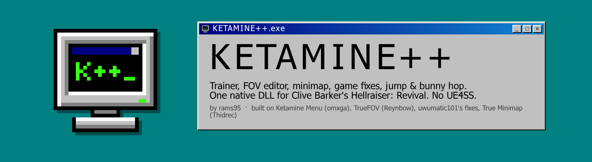
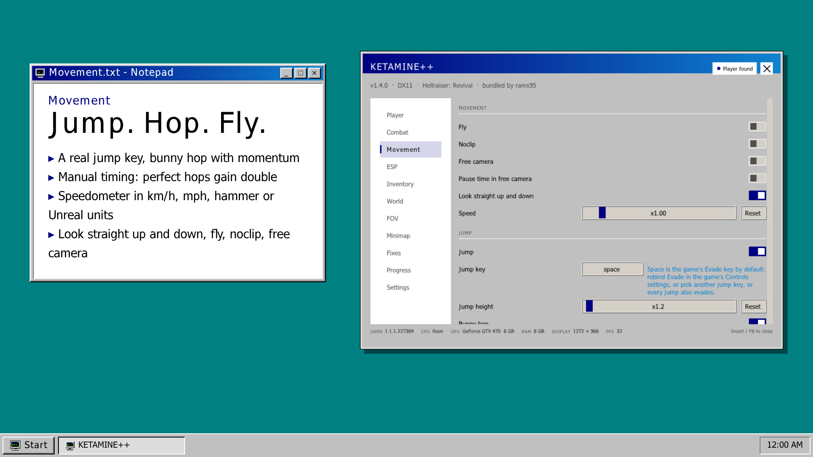
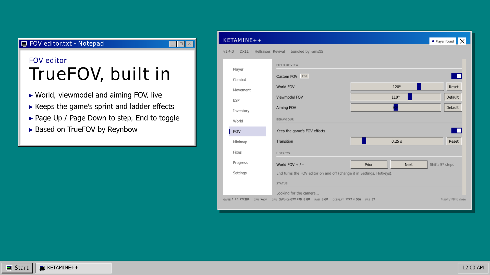
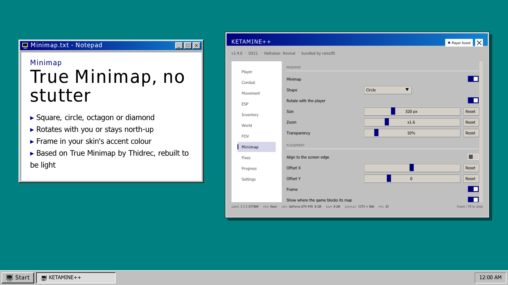
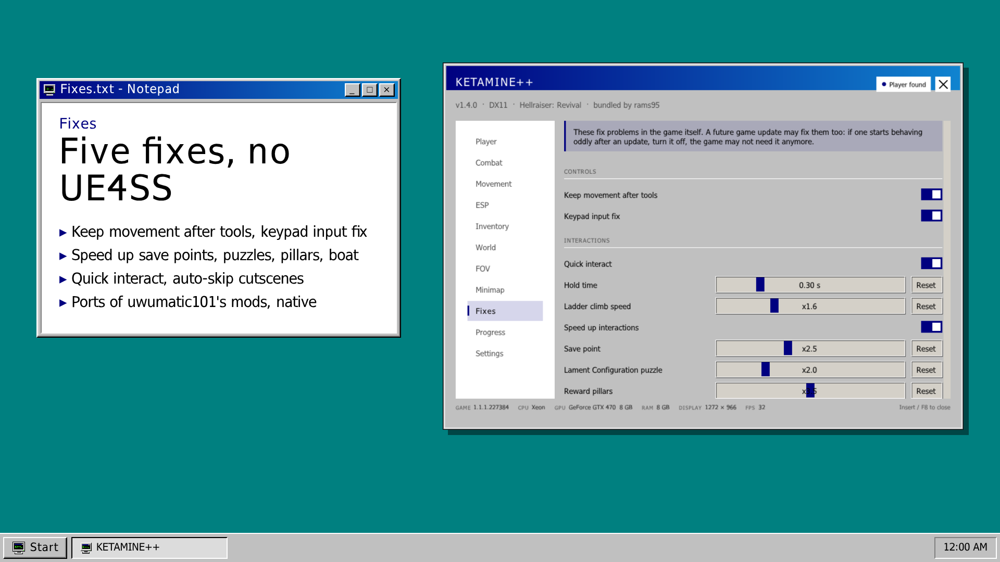
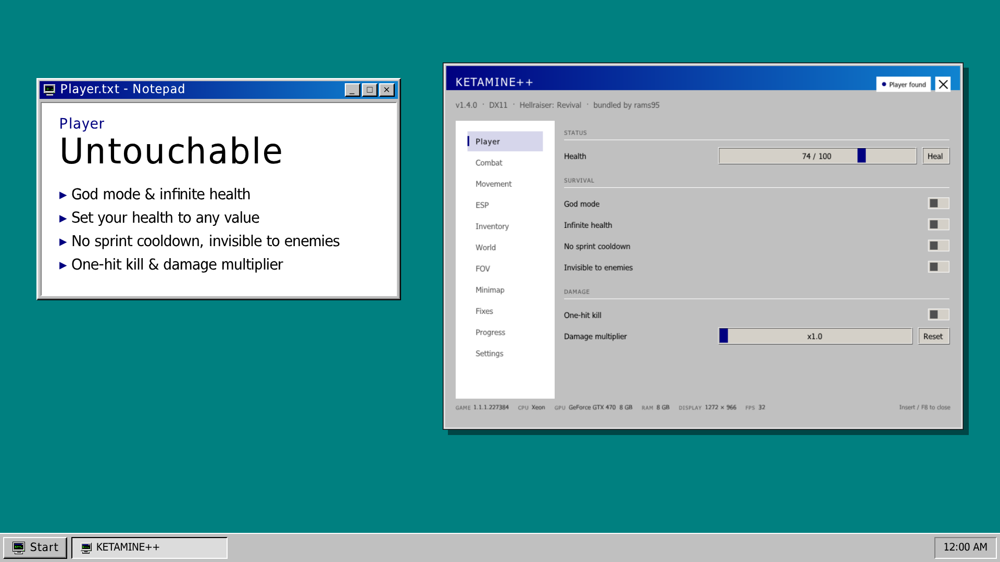
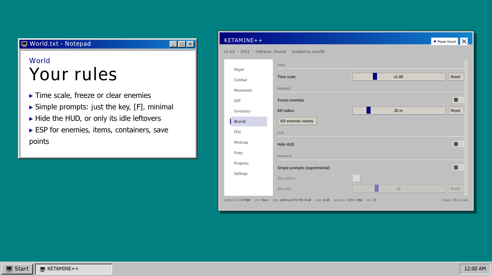
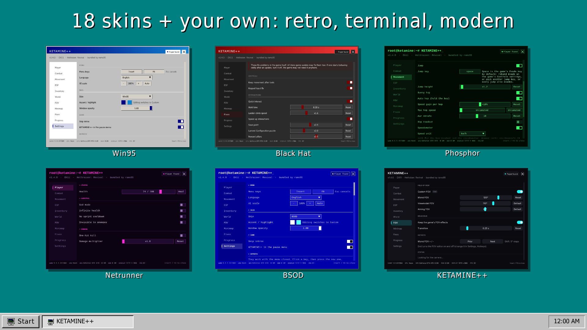

  

<h1 align="center">KETAMINE++</h1>

  Trainer, FOV editor, minimap, game fixes, jump &amp; bunny hop: <b>one native DLL</b> for Clive Barker's Hellraiser: Revival. 
  No UE4SS, no launcher. Press <b>F1</b> or <b>F8</b>, or pick <b>KETAMINE++</b> in the game's pause menu.

  <a href="https://github.com/rams95blue/KETAMINE-PlusPlus/releases">Download</a> ·
  <a href="KETAMINE++.md">Changes &amp; technical notes</a> ·
  <a href="https://github.com/rams95blue/KETAMINE-PlusPlus/issues">Report a bug</a> ·
  <a href="https://www.nexusmods.com/clivebarkershellraiserrevival/mods/47">Nexus page)</a>

---

KETAMINE++ by **[rams95](https://github.com/rams95blue)** bundles a trainer and five community mods into one file,
rewritten natively (C++, no UE4SS, no Lua), with new features on top:

| Built on | By | Links |
| --- | --- | --- |
| Hellraiser Revival's Ketamine Menu (the trainer) | omxga | [Nexus](https://www.nexusmods.com/clivebarkershellraiserrevival/mods/27) · [GitHub](https://github.com/literalynn/Hellraiser-Revivals-Ketamine-Menu) |
| TrueFOV (FOV editor) | Reynbow | [Nexus](https://www.nexusmods.com/clivebarkershellraiserrevival/mods/12) · [GitHub](https://github.com/Reynbow/HellraiserFOV) |
| ToolInputFix, KeypadInputFix, SpeedUpInteractions, QuickInteract, CutsceneAutoSkip | uwumatic101 | Nexus [42](https://www.nexusmods.com/clivebarkershellraiserrevival/mods/42) · [43](https://www.nexusmods.com/clivebarkershellraiserrevival/mods/43) · [44](https://www.nexusmods.com/clivebarkershellraiserrevival/mods/44) · [45](https://www.nexusmods.com/clivebarkershellraiserrevival/mods/45) · [46](https://www.nexusmods.com/clivebarkershellraiserrevival/mods/46) |
| Hellraiser True Minimap | Thidrec | [Nexus](https://www.nexusmods.com/clivebarkershellraiserrevival/mods/39) |

   
   
   
  

## Features

- **Trainer** (Ketamine Menu): god mode, infinite health and ammo, unbreakable weapons, silent aim, one-hit kill, ESP,
  items and money, fly / noclip / free camera, teleports, time scale, objectives, a hotkey for every switch.
- **Genesis Configuration**: shows what your save has; no-cost / no-cooldown powers start off at every load.
- **Jump and bunny hop**: a jump key (the game has none), auto or manually timed hops with momentum in every direction,
  air strafing, no speed cap; a speedometer in km/h, mph, hammer units or Unreal units.
- **Look straight up and down**: lifts the game's 60° / 70° look limit.
- **FOV editor** (TrueFOV): world, viewmodel and aiming FOV, gameplay only, keeps sprint / ladder FOV effects.
- **Minimap** (True Minimap): square, circle, octagon or diamond, rotating with you or north-up, framed in your
  skin's colour, without the original's stutter.
- **Fixes** (uwumatic101): movement kept after tools, keypad input, sped-up save points / puzzles / pillars / boat,
  quick interact, cutscene auto-skip; plus hiding the "DROP [Z]" hint when the HUD goes idle.
- **Simple prompts** (experimental): prompts become plain text, `[F] Barter`, in your colour and size.
- **Pause menu entry**: a KETAMINE++ item under the game's pause menu.
- **18 skins + your own**: retro Windows (Win95, Black Hat, Zero Day), terminal (Phosphor, Amber CRT, Root Shell,
  Mainframe, Netrunner, BSOD) and modern, each with its own font and cursor.
- 9 languages, UI scale, skip intros, an in-game UI dump for modders.

The full list, the defaults and the technical notes (performance fixes, the audit of the original fixes) are in
[KETAMINE++.md](KETAMINE++.md).

## Install

1. In Steam: right-click the game → **Manage** → **Browse local files**, then open `Hellraiser\Binaries\Win64`.
2. Copy `winmm.dll` there (and `KetaminePlusPlus.ini` for the default settings).
3. Remove what KETAMINE++ replaces: the original Ketamine Menu or TrueFOV `winmm.dll`, and the UE4SS versions of the
   bundled mods in `ue4ss\Mods`. An existing `KetamineMenu.ini` is copied over on the first start.
4. Start the game, load a save, press **F1** or **F8**.

Linux / Steam Deck (Proton): add `WINEDLLOVERRIDES="winmm=n,b" %command%` to the game's launch options.

## First steps

1. **Open** with F1 / F8 (the X closes it), or click **KETAMINE++** in the pause menu.
2. **Skin**: Settings → Skin. Win95 is the default.
3. **Jump**: Space jumps but is also the game's Evade: rebind Evade in the game's Controls or pick another jump key.
4. **Bunny hop**: hold jump (auto hop), or turn auto hop off and press jump as you land. Speedometer in Movement.
5. **FOV**: 120° / 110° / 90° by default; Page Up / Page Down in game, End toggles.
6. **Minimap**: off by default; turn it on, and open the TAB map once per level.
7. **Fixes**: all on except cutscene skip. If one acts odd after a game update, turn it off.

Back up `%LOCALAPPDATA%\Hellraiser\Saved\SaveGames` before you play, and save before giving key items or completing
objectives.

## Building

- Windows / MSVC: `cmake -S . -B build -A x64 && cmake --build build --config Release`
- Linux cross-build (how the releases are built): `./build-mingw.sh` with clang 18, lld, mingw-w64 and the
  ImGui v1.92.9 / MinHook v1.3.4 sources in `deps/`.

The Nexus page images are rendered from `docs/nexus/src` (HTML + Playwright) and in-menu screenshots.

## Credits

- **rams95** ([github.com/rams95blue](https://github.com/rams95blue)): KETAMINE++, bundling it all together with the added features
- **omxga** (literalynn): Hellraiser Revival's Ketamine Menu (MIT); its README is in [docs/README-KetamineMenu.md](docs/README-KetamineMenu.md)
- **Reynbow**: TrueFOV · **uwumatic101**: the five fixes · **Thidrec**: True Minimap
- [Dear ImGui](https://github.com/ocornut/imgui) (MIT), [MinHook](https://github.com/TsudaKageyu/minhook) (BSD-2-Clause),
  [Inter](https://github.com/rsms/inter) (OFL 1.1); licences in [THIRD-PARTY-NOTICES.txt](THIRD-PARTY-NOTICES.txt)

KETAMINE++ is a fan-made tool, not affiliated with or endorsed by Saber Interactive, Boss Team Games or Clive Barker.
Use it at your own risk. Licence: [MIT](LICENSE).
